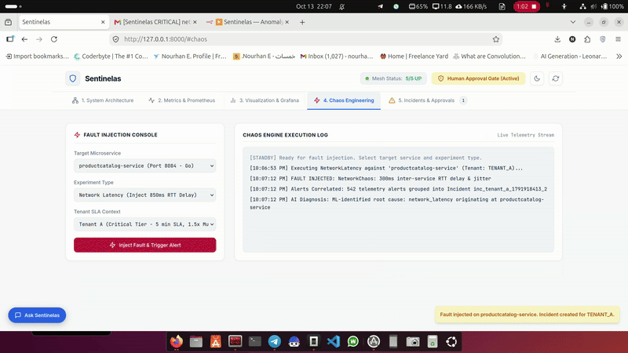
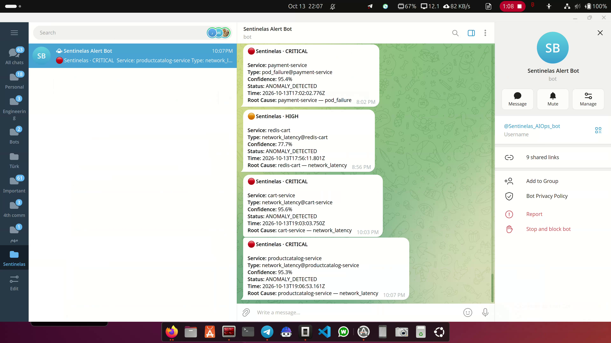

# Sentinelas: Autonomous AIOps & Self-Healing Platform

> **NTI Graduation Project**  
> An autonomous, chaos-grounded AIOps platform featuring multi-tenant SLA protection, real-time alert correlation, AI-guided root cause analysis (RAG & ML), and automated Ansible self-healing remediation.

---
## Technical Demo



[](https://youtu.be/eAkVeYpkTnA)

▶️ **Click the image above to watch the full technical walkthrough** of the platform: incident detection, correlation, and AI root-cause investigation.

## Architecture & System Overview

Sentinelas bridges observable telemetry and autonomous site reliability engineering (SRE) through a closed-loop feedback pipeline:

```
[ Microservice Mesh / K8s ] ──> [ Prometheus Telemetry ] ──> [ Sliding-Window Correlation ]
                                                                       │
[ Ansible Self-Healing ] <── [ Human-in-the-Loop Gate ] <── [ ReAct AI SRE Agent + RAG ]
```

1. **Local Microservice Mesh & K8s:** Multi-service topology (Payment, Cart, Frontend, Product Catalog, Redis) running natively with process isolation and Kubernetes pod mapping.
2. **Prometheus Telemetry Exporter:** Native `/metrics` scrapers reporting live CPU, RSS memory, request rates, HTTP 5xx errors, and latency distributions.
3. **Chaos Engineering Studio:** Real socket-level failure injection (`PodFailure`, `StressChaos`, `NetworkLatency`) targeting configurable tenant SLAs.
4. **Alert Clustering & Noise Reduction:** Sliding-window deduplication and correlation engine that compresses hundreds of cascading raw alerts into a single actionable Incident.
5. **Multi-Tenant SLA Risk Engine:** Dynamic priority ranking (`P1-CRITICAL` to `P4-LOW`) with real-time risk acceleration and Time-to-Breach (TTB) tracking.
6. **AI SRE Root Cause Analysis:** Dual-engine RCA combining ReAct tool-calling, semantic RAG over ChromaDB runbooks, and a trained ML pipeline (Isolation Forest + Tree Regressor).
7. **Human Approval Gate & Ansible Remediation:** Switchable Autonomous / Operator-Approved execution of real `ansible-playbook` rollout restart self-healing routines.
8. **Observability & Alerting Integrations:** n8n webhook workflow dispatching incident anomalies to Telegram and email; conversational Sentinelas AI Assistant querying documentation.

---

## Multi-Tenant SLA Protection Tiers

| Tenant Tier | SLA Window | Risk Acceleration | Workload Profile |
| :--- | :--- | :--- | :--- |
| **Tenant A (Critical)** | **300s (5 min)** | **1.5x Multiplier** | Real-time payment processing & checkout transactions |
| **Tenant B (Standard)** | **900s (15 min)** | **1.0x Baseline** | Interactive catalog browsing & shopping cart sessions |
| **Tenant C (Low / Batch)** | **1800s (30 min)** | **1.0x Standard** | Asynchronous recommendation generation & background workers |

---

## Repository Structure

```text
NTI_Project_Sentinelas/
├── ansible/                  # Ansible self-healing playbooks & inventory
│   ├── inventory.ini
│   ├── restart_service.yml   # Deployment rollout & pod self-healing playbook
│   └── clean_disk.yml
├── backend/                  # FastAPI Sentinelas Core Engine
│   ├── app/
│   │   ├── agent/            # ReAct AI SRE Agent & LLM tool-calling
│   │   ├── api/              # Mesh, alerts, chaos, SLA, chat, & incident APIs
│   │   ├── chat/             # Sentinelas AI Assistant (RAG over docs)
│   │   ├── correlation/      # Sliding-window alert clustering engine
│   │   ├── mesh/             # Real microservice supervisor & Prometheus exporter
│   │   ├── ml/               # Anomaly detection & ML RCA inference pipeline
│   │   ├── rag/              # ChromaDB vector store & semantic runbook retriever
│   │   ├── sla/              # Multi-tenant SLA calculator & priority ranker
│   │   └── webhooks/         # n8n notification dispatchers
│   ├── runbooks/             # Markdown SOPs & troubleshooting runbooks
│   ├── static/
│   │   └── index.html        # Sentinelas Command Center Web UI (Light/Dark themes)
│   ├── tests/                # Automated pytest test suites
│   ├── Dockerfile
│   └── requirements.txt
├── dashboard/                # Standalone React + Vite Observability Dashboard
├── data/                     # Labeled chaos telemetry & baseline datasets
├── k8s/                      # Kubernetes manifests (Online Boutique, Metrics Server)
├── n8n/                      # n8n workflow configurations & alerting simulation
├── terraform/                # Infrastructure-as-Code definitions
├── jenkins/                  # CI/CD Jenkinsfile automation pipeline
├── Makefile                  # Build, test, and execution commands
└── run.sh                    # Unified development runner
```

---

## Quick Start

### 1. Prerequisites
- Python 3.12+
- `kubectl` & local Kubernetes cluster (`k3s` or `minikube`)
- `ansible-core`

### 2. Setup Virtual Environment & Dependencies
```bash
make setup
```

### 3. Run the Automated Test Suite
```bash
make test
```

### 4. Start the Sentinelas Engine
```bash
./run.sh dev-backend
```
- **Web UI & Command Center:** [http://localhost:8000](http://localhost:8000)
- **Interactive OpenAPI Documentation:** [http://localhost:8000/docs](http://localhost:8000/docs)
- **Live Prometheus Metrics:** [http://localhost:8000/api/v1/mesh/metrics](http://localhost:8000/api/v1/mesh/metrics)

---
## AI & Intelligence Layer

Sentinels Platform goes beyond classic DevOps monitoring by adding an AI layer that detects anomalies, explains them, and recommends solutions, all running with a locally hosted LLM.

### Anomaly Detection & Solution Prediction
- **Isolation Forest**: an unsupervised ML model trained on the platform's telemetry (metrics, logs, and incident data) to detect abnormal behavior without needing labeled attack data.
- **LLM (Llama, running locally)**: takes the detected anomaly together with its context and correlated signals, then performs root-cause investigation and predicts the most likely solutions and remediation steps. Because the model runs locally, no operational data leaves the infrastructure.

### RAG (Retrieval-Augmented Generation)
The platform includes a RAG system that grounds the LLM's answers in real, relevant knowledge instead of relying only on the model's general training:
- Relevant documents and context (for example runbooks, past incidents, and platform documentation) are retrieved at query time.
- The retrieved context is passed to Llama together with the question, producing more accurate and platform-specific root-cause analysis and recommendations.
- Vector store
- Embedding model

### AI Chat Assistant
A built-in chat assistant powered by the local **Llama** model and the RAG system, letting engineers talk to the platform in natural language, for example:
- Ask what is happening in the system right now
- Investigate an incident and get a root-cause explanation
- Get recommended fixes and next steps based on platform knowledge

### Real-Time Alerting System (n8n)
Alerting is built as automated workflows in **n8n**. When an attack or a chaos event is detected, n8n routes the alert and notifies people immediately through two channels:

| Channel | Purpose |
|---------|---------|
|  **Telegram Bot** | Instant notification with incident details |
|  **Gmail** | Email alert sent to the whole team |

Alerts are triggered by:
-  Security attacks or suspicious activity
-  Chaos events (failures, resource exhaustion, service disruption)

### How It Works
```text
Telemetry → Isolation Forest (anomaly detection)
          → RAG retrieval (relevant context) + Llama (root cause & solution prediction)
          → n8n workflow → Telegram + Gmail alerts
          → AI Chat Assistant (investigation & follow-up)
```
---

## License & Credits
Developed as an engineering graduation project for the **National Telecommunication Institute (NTI)**.
Distributed under the MIT License.
